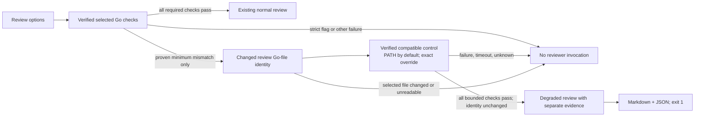

# Design Spec: Honest Review Continuation

## Purpose

By default, let `atom review` continue after one narrowly demonstrated Go-version incompatibility while preserving the failed selected-toolchain evidence and labeling the review degraded. A caller may opt into strict toolchain enforcement, which blocks even that proven incompatibility. Source defects, ambiguous failures, and unverified control runs remain blocking in either mode.

## Evidence Base

Phase POC report: [Compiled-Timeout Classification Batch](../poc-report-compiled-timeout.md)

**Established by the POC, within its bounded Windows fixture matrix:**

- Across two sweeps, the only failed selected build admitted as degraded was a valid fixture whose selected Go 1.26.9 was below its `go.mod` minimum; the same frozen source passed compatible Go 1.27.3 control checks.
- The degraded stub prompt preserved selected build as failed, downstream selected checks as skipped, and control results as separate evidence. It did not treat the control as a pass under the selected compiler.
- Source defects, missing selection, timeout, failed control, changed source, and mixed/ambiguous outcomes did not reach the reviewer stub.
- The direct compiled-test timeout observed the entry marker and cleanly timed out, but it did not reproduce or fix the earlier Go-supervised Windows cleanup failure.

**Product decisions from the developer, not established by the POC:**

- Continuation for the single proven incompatibility class is the default; strict toolchain enforcement is opt-in.
- The default control candidate is the machine's PATH Go distribution, but only after its exact version and executable identity are verified. An exact control-version override may be supplied. This selection policy was not tested in the POC.
- A degraded review remains a non-zero CLI result and is identified by a versioned JSON contract. These choices were not tested by the POC.

**Other assumptions, not established by the POC:**

- Production Git-source integration can identify and re-read the changed Go-file paths captured for this review; the scoped POC did not exercise the Python capture/gate pipeline. This guard will not establish that all inputs consumed by module-wide checks stayed unchanged.
- The fixture matrix used standard-library-only Go code. Dependency-heavy modules, workspaces, CGO, race detection, advisory analyzers, and non-Windows platforms are not proven by this POC.
- A local PATH Go executable that is not a direct verified Go distribution can be safely rejected as an unusable control candidate without changing user toolchain policy.

## Review-Finding #2 Scope Amendment (Approved)

The developer chose to identify only changed Go-file paths captured in the selected review snapshot, accepting that changes to other module files are not detected by this guard. The scoped POC report is [Review-Snapshot Input Identity](../poc-report-review-snapshot-fingerprint.md). It demonstrated selected-path mutation detection without reading unrelated files in a 1,002-file fixture. It did not demonstrate production Git capture integration, failure cases, or that module-wide checks consume only those paths. The implementation and tests must preserve the limited claim stated in B7; they must not present it as whole-module input identity.

## Design Overview

Normal reviews retain the existing all-gates behavior unless the request is a default-mode continuation candidate: a Go module is present, the selected Go distribution was explicitly requested and verified, and its observed version is below the unambiguously parsed module minimum. For that candidate only, run selected formatting first. A format failure or non-completed result blocks the attempt without running selected build or control. If formatting passes, run selected build. If build completes with a non-zero exit, record vet/test/race as skipped specifically because that build failed, do not execute them under the selected compiler, and evaluate the remaining continuation criteria. A build timeout, missing tool, or runner error is blocking and never enters control checks. If build passes, run the remaining selected required gates normally. Strict mode, unpinned reviews, and requests that do not meet the candidate preconditions keep the existing all-gates collection behavior; strict mode blocks any required selected failure without control checks.

A stable fingerprint of the selected changed Go-file paths plus a verified compatible control run are still required. This is intentionally narrower than whole-module identity. Control success permits reviewer invocation but never changes selected gate results or excludes categories from reviewer attention. The Markdown/JSON output labels the run degraded. The CLI exits with `EXIT_CHECK_FAILED` even when model responses are complete.

## Public Surface

There is no exported Go API: this repository's implementation is Python. The public surface for this phase is the `atom review` CLI.

| Option | Contract |
|---|---|
| `--strict-toolchain` | Opt into strict behavior: any required selected-toolchain failure blocks reviewer invocation, including the proven minimum-version incompatibility. Default is continuation for that proven class only. |
| `--control-go-version 1.X.Y` | Optional exact locally installed control Go override. Without it, use the direct Go distribution on PATH after exact-version and executable verification. It must meet or exceed the parsed module minimum. No download or installation is attempted. Requires an explicit selected compiler via `--go-version` or `--go-executable`; otherwise it is a usage error because no continuation control can be selected. Also invalid with `--strict-toolchain` or `--skip-toolchain`. |
| Existing `--go-version` / project `review_go_version` | Continues to select the requested compiler. The incompatibility classifier requires a verified selected version; absent or unverified selection remains blocking. |

No persistent configuration default is added. No automatic toolchain download, user-default mutation, or silent selected-version substitution is performed.

## Types And Responsibilities

| Existing or proposed internal responsibility | Module |
|---|---|
| Keep requested, observed, and hashed selected/control Go distributions distinct | `atom.go_selection` |
| Collect selected gates, control gates, and explicit continuation classification without merging their statuses | `atom.toolchain` |
| Preserve command lifecycle outcomes so timeout/missing/runner errors are not inferred from diagnostic text | `atom.gates` |
| Apply the narrow structured eligibility rules before model invocation | `atom.review` |
| Validate options and preserve strict/degraded exit semantics | `atom.cli` |
| Render selected/control evidence and degraded status in Markdown and JSON | `atom.report` |

The classifier is an internal decision over structured versions, gate results, command lifecycle outcomes, and changed-review-file identity evidence. The existing `source_fingerprint` report field represents only the digest of selected changed-Go-file paths, not the whole module. The classifier distinguishes completed non-zero exits from timeout, missing-tool, and runner-error outcomes; it does not classify from compiler-output text or fixture labels.

## Behaviour

1. With no `--strict-toolchain`, a review whose selected required gates all pass follows the existing normal-review path. No control compiler is run.
2. With `--strict-toolchain`, any required selected-toolchain failure follows the existing fail-before-model path. No control checks are run, including for the proven incompatibility. Combining this option with `--control-go-version` or `--skip-toolchain` is a usage error before compiler or model commands. Supplying `--control-go-version` without an explicit selected compiler via `--go-version` or `--go-executable` is also a usage error before commands.
3. Default continuation is considered only when a Go module is present, the selected Go distribution was explicitly requested and verified, the module minimum parses unambiguously, and the observed selected version is below that minimum. Missing, malformed, unsupported, or ambiguous version evidence remains blocked. Filesystem or UTF-8 decoding failures while reading `go.mod` block continuation with a contextual diagnostic rather than escaping as an unhandled exception.
4. For a default-mode continuation candidate, run selected `fmt` first. If formatting fails or does not complete, block without running selected `build` or control checks. If formatting passes, run selected `build`. The eligible shape requires a completed non-zero build exit; then record required `vet`, `test`, and `race` checks as skipped specifically because the build failed, without executing them under the selected compiler. A build pass runs the remaining selected required gates normally; a build timeout, missing tool, runner error, any independent required-gate failure/skip, or unknown command outcome is ineligible and blocks continuation. No compiler diagnostic text is used as proof.
5. The control distribution is the direct Go executable on PATH by default. It must be resolved and verified as an exact installed distribution, including observed version and executable identity, and its version must meet or exceed the module minimum. `--control-go-version` instead requests that exact installed version through the existing local resolver. Missing, unverified, or incompatible control Go blocks review; there is no version search, download, installation, or retry.
6. The bounded control set is `gofmt` over the same frozen changed Go-file snapshots used by selected formatting, plus `go build ./...`, `go vet ./...`, and `go test ./...`, all run once under the verified control distribution. The control formatter must use the control distribution on exactly those snapshots; unrelated module files do not participate in the control `fmt` verdict. An empty changed-file formatting scope remains skipped, not passed, and cannot qualify a review for continuation. Every control gate must pass. Race detection and advisory analyzers are not part of this POC-proven control set; they remain explicitly unchecked and are never represented as passing.
7. A deterministic fingerprint covers only the changed Go-file paths in the frozen `ChangedFilesFormatGate` snapshot, sorted by module-relative path, using each live file path and its bytes. If that formatting scope is unavailable, block before selected checks. Capture the fingerprint before selected checks and again after control checks. For a `--working` diff, the initial live-file bytes must also match the captured `FormattingFile.content`; if the file changed between diff capture and the initial identity check, block before selected checks rather than accepting the changed bytes as the baseline. For `--staged` and `--branch`, the captured Git blob may intentionally differ from the live worktree, so do not require equality; fingerprint the live worktree paths consumed by build, vet, and test before and after the checks. A selected live path that is missing, unreadable, a symlink, non-regular, changes after the baseline, or is replaced between path validation and file opening makes this scoped identity unknown and blocks continuation. Before reading, compare the opened handle's device and inode with the final `lstat` identity so a pathname swap cannot redirect the fingerprint. Do not traverse or hash other module files; changes to files outside the selected changed-Go-file set are intentionally not detected by this guard. The identity guard does not establish that staged/branch formatter snapshots match the live worktree inputs to module-wide checks, does not cover every input consumed by build, vet, and test, and does not prove that toolchains are behaviorally equivalent.
8. The control set runs only when the selected gates exhibit the eligible failure shape. If selected required checks all pass, ordinary review proceeds without a control compiler invocation.
9. When eligible control checks pass and the selected changed-Go-file paths remain unchanged, review proceeds with degraded status. Selected `fmt` pass, selected `build` failure, and selected skipped results remain unchanged; control results are stored and rendered separately.
10. The model prompt explicitly says the selected compiler did not pass, control passes do not validate the requested compiler, and race/advisory checks were not established by control. No category is excluded from reviewer attention based solely on a control pass.
11. Markdown and JSON identify a degraded review and include selected and control evidence separately. The existing JSON `source_fingerprint` field means only the digest of selected changed-Go-file paths. Other existing JSON fields retain their meanings; the review JSON schema version increments from 2 to 3 to represent the new contract.
12. A degraded report is written to stdout with an explicit degraded warning on stderr. The CLI returns `EXIT_CHECK_FAILED` (`1`) even if every model response is usable. Existing partial/no-usable-response behavior remains unchanged.
13. If control selection, a control command, or selected changed-Go-file identity verification fails, times out, is skipped, or is ambiguous, no reviewer is invoked and the CLI follows the existing toolchain failure path with exit `1`; no success-shaped review report is emitted.
14. `--skip-toolchain` retains its existing meaning and does not create, label, or imply a degraded review. Combining `--control-go-version` with `--skip-toolchain` is a usage error. `--control-go-version` also requires explicit `--go-version` or `--go-executable`; otherwise reject it as a usage error rather than silently ignoring the requested override. The direct test-binary diagnostic does not change the production command runner or make Go-supervised timeouts eligible.

## Error Handling

| Condition | Behaviour | Observable result |
|---|---|---|
| `--strict-toolchain` combined with `--control-go-version` or `--skip-toolchain`, or `--control-go-version` without explicit `--go-version`/`--go-executable` | Reject before compiler checks or models | Usage message on stderr; `EXIT_USAGE_ERROR` (`2`) |
| Selected toolchain is unverified, module minimum is unknown, module-minimum read fails, or selected failure shape differs | Block reviewer invocation | Contextual module/toolchain diagnostic on stderr; `EXIT_CHECK_FAILED` (`1`) |
| Selected candidate build times out, is missing, or has a runner error | Do not start control checks; block reviewer invocation | Explicit selected-command diagnostic; exit `1` |
| Default PATH control is missing, indirect, below minimum, or cannot be verified | Do not substitute, download, or invoke models | Explicit control-selection failure; exit `1` |
| Requested exact control Go is unavailable, below minimum, or cannot be verified | Do not substitute, download, or invoke models | Selection diagnostics; exit `1` |
| Control gate fails, times out, or is unchecked | Do not invoke models | Separate control result and blocking diagnostics; exit `1` |
| A selected changed-Go-file identity cannot be established, changes, or is redirected between path validation and open | Treat scoped classification as unknown; do not invoke models | Blocking failure; exit `1` |
| Control passes and selected changed-Go-file identity is stable | Invoke reviewers with degraded evidence; never convert selected failures to passes | Markdown/JSON report; stderr warning; exit `1` |

## Concurrency

- Selected and control command sets run sequentially through the existing command runner; the control does not overlap selected checks.
- No new threads, tasks, shared mutable state, or cancellation mechanism are introduced by this phase.
- Existing model-call concurrency begins only after the selected/control decision and remains governed by `--concurrency`.
- Review invocation state remains per-run; concurrent CLI processes do not share continuation state.

## Extension Points

- Keep classification in one internal helper that consumes structured toolchain and changed-review-file identity evidence; future proven incompatibility classes can be added as explicit predicates without weakening this class.
- Keep control evidence distinct in `ToolchainEvidence` so reports can render it without rewriting selected results.
- A future control-discovery policy or additional control checks requires separate evidence and approval; this phase does not infer either from the fixture matrix.

## Trade-offs Considered

| Option | Chosen? | Reason |
|---|---|---|
| Block every selected-toolchain failure by default | No | The developer chose default continuation for the one proven incompatibility class. |
| Continue by default for every tool failure | No | The POC showed source, timeout, missing-tool, failed-control, changed-source, and mixed/ambiguous outcomes must remain blocked. |
| Default to the verified PATH Go, with an exact override | Yes — developer-directed; PATH verification remains an assumption | Avoids requiring an extra option in the common case while refusing to guess or install a compiler. |
| Opt-in strict behavior through `--strict-toolchain` | Yes — approved | Provides a visible override that blocks even the proven continuation class. |
| Match compiler error strings to classify incompatibility | No | Structured minimum/version and control evidence are stronger; text matching can misclassify source or mixed failures. |
| Let control passes overwrite selected failures | No | Contradicts the POC's degraded prompt evidence and falsely claims the selected compiler passed. |
| Return exit `0` for a complete degraded review | No — approved | A complete model review is not a passing selected-toolchain validation; keep the CI signal non-zero. |
| Keep schema v2 without an explicit degraded field | No — approved | Consumers need a machine-readable distinction; preserve existing field meanings and increment to v3. |
| Treat control race/advisory checks as proven | No | The POC did not cover those checks; they remain unchecked and visible. |
| Hash every module file for selected/control identity | No — fingerprint only changed Go-file paths in the captured review snapshot | Avoids traversing and reading unrelated files. The developer accepts that changes outside this set are not detected; module-wide build, vet, and test still run. |
| Format the entire module under the control compiler | No — use the selected diff's frozen changed Go-file snapshots | Keeps the control `fmt` verdict in the same review scope; unrelated pre-existing files must not block a diff-scoped review. Build, vet, and test remain module-wide. |
| Run all selected dependent gates after a candidate build failure | No — developer-directed short-circuit for the continuation candidate only | Dependent failures from a rejected minimum may mask the POC-proven case; compatible control reruns the bounded required checks. Normal, strict, and non-candidate reviews retain existing all-gates behavior. |

## Out Of Scope

- Repairing the original Go-supervised Windows process cleanup/output-collection failure or changing process-runner semantics.
- Repairing or explaining the parent PR's macOS/Windows CI failures.
- General compiler-version compatibility detection, diagnostic-text matching, automatic retries, toolchain downloads, or replacement of the selected compiler.
- Claiming selected-compiler success, running real models during the POC, or treating `--skip-toolchain` as validation.
- Workspaces, multi-module trees, CGO, cross-platform reliability, dependency behavior beyond the fixture evidence, race detection, and advisory-analyzer control evidence. The changed-file identity guard does not detect changes to module inputs outside the captured changed Go-file paths. Symlinks at selected changed paths block; unrelated symlinks are not traversed. If required selected-path identity or gate evidence cannot be established, the result is blocked rather than generalized.

## Completeness Checklist

- [x] Purpose states the new capability this phase enables.
- [x] Phase POC report is linked.
- [x] Established evidence, developer decisions, and assumptions are separated.
- [x] Every significant design decision traces to evidence, developer direction, or a labeled assumption/proposal.
- [x] Diagram uses Mermaid only.
- [x] Public surface is minimal and accurately identifies the Python CLI; no Go API is invented.
- [x] Behaviours are numbered and independently testable.
- [x] Error behavior and exit values are explicit.
- [x] Concurrency contract is explicit; no new concurrent work is introduced.
- [x] Rejected trade-offs and out-of-scope cases are recorded.
- [x] Developer approval at the amended design gate (2026-11-03).
